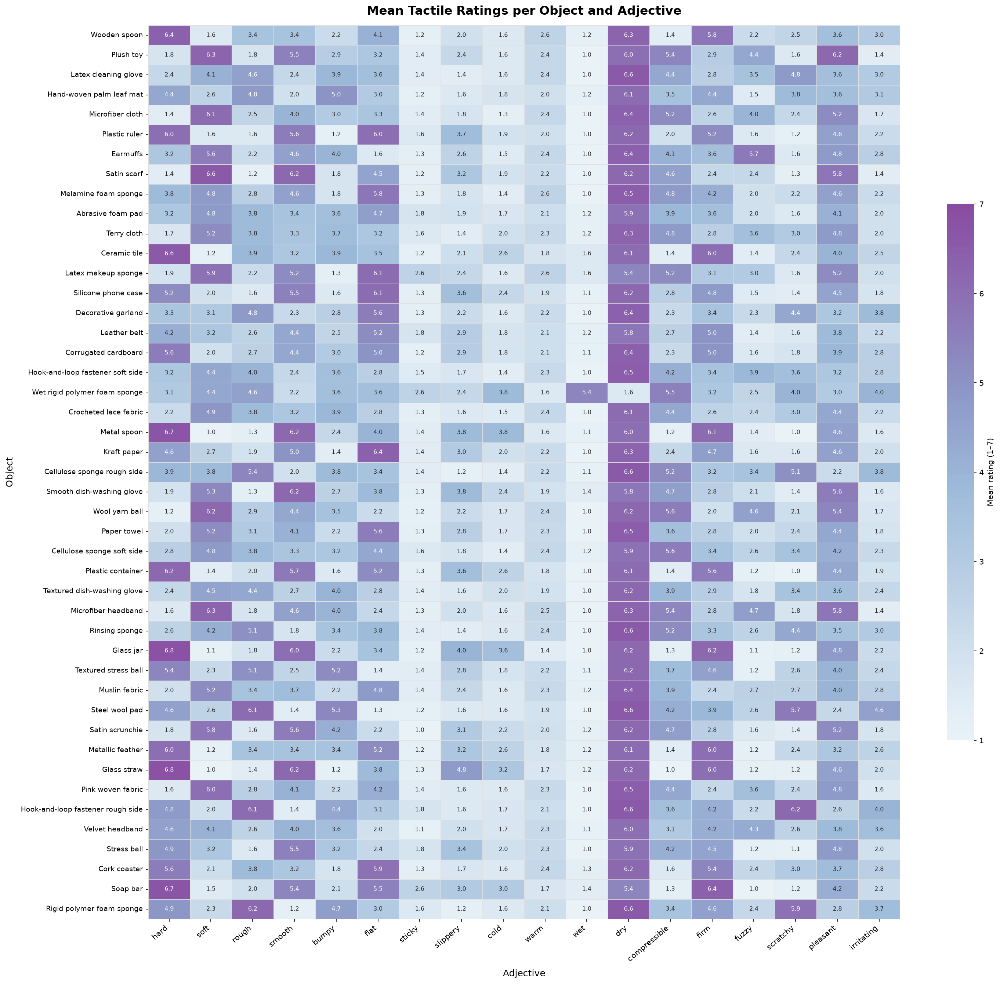
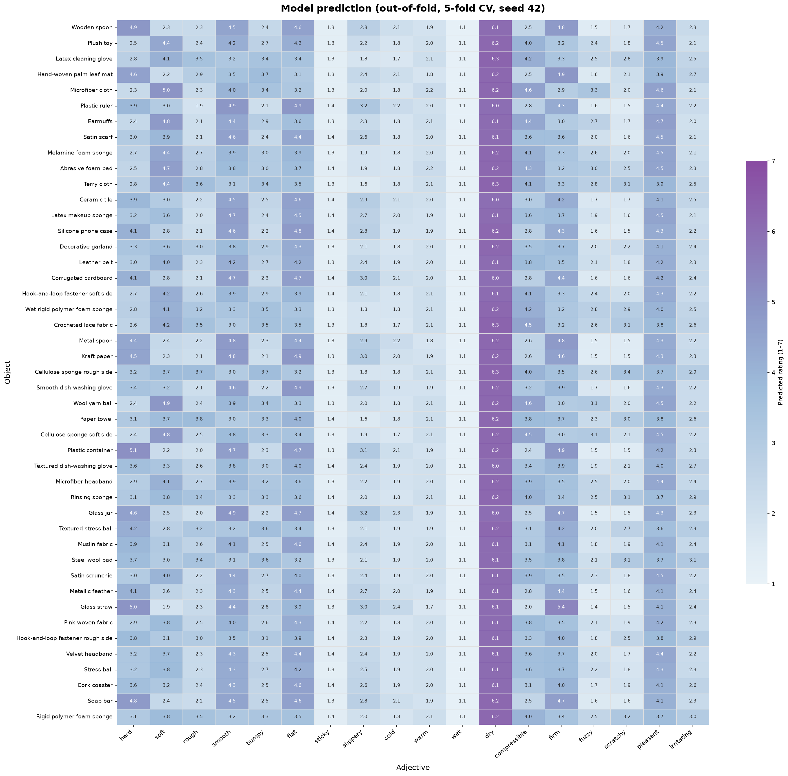
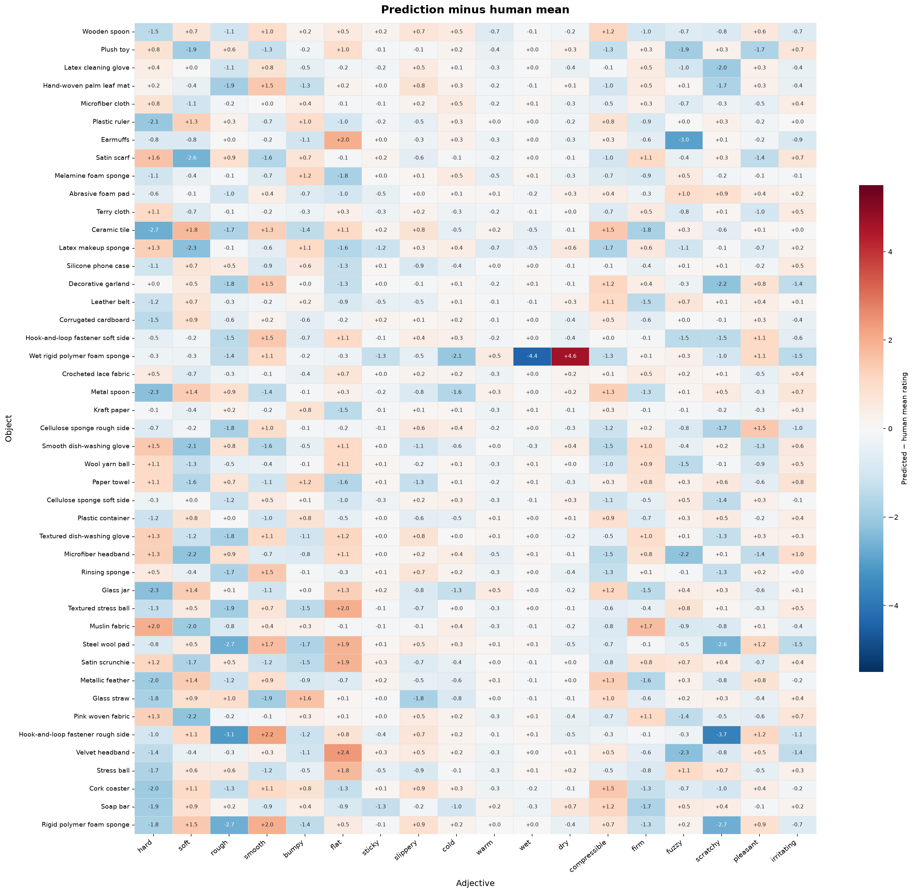
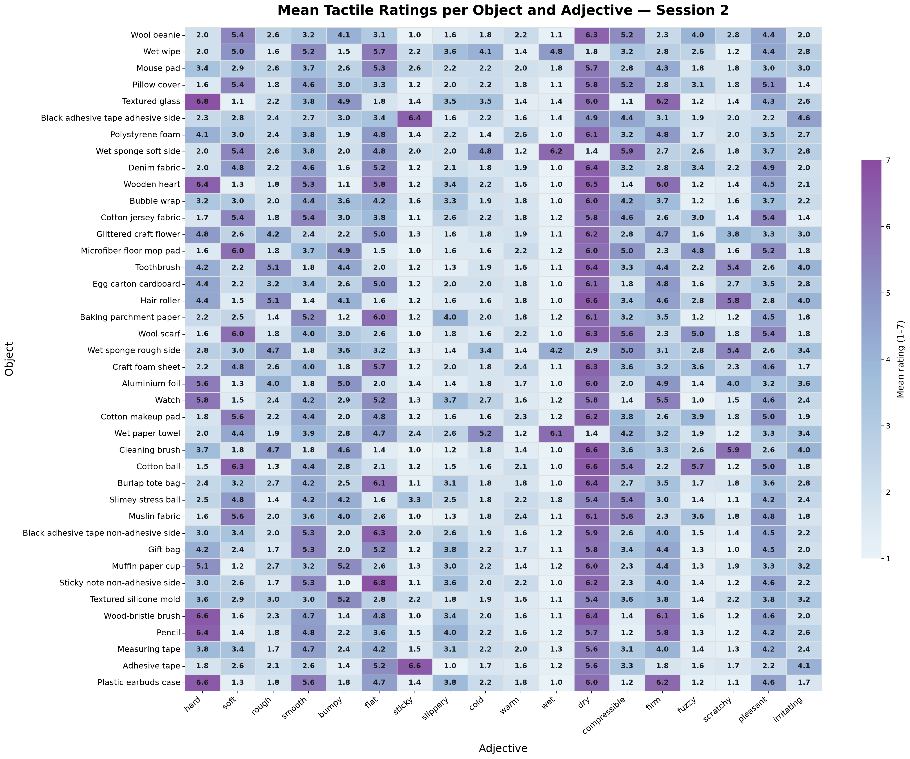
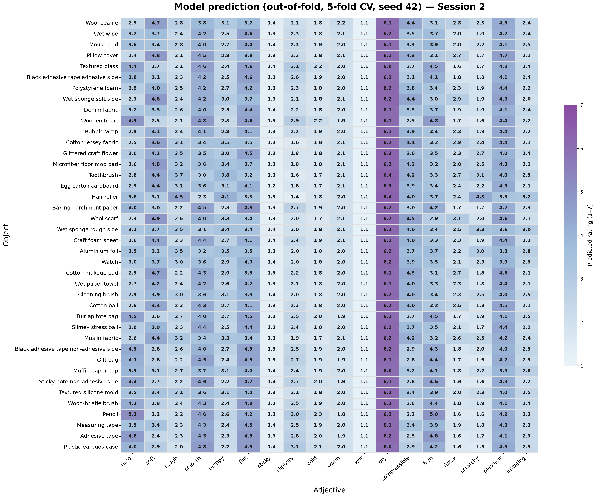
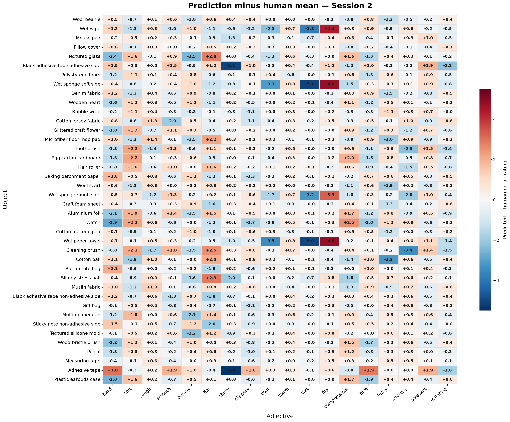
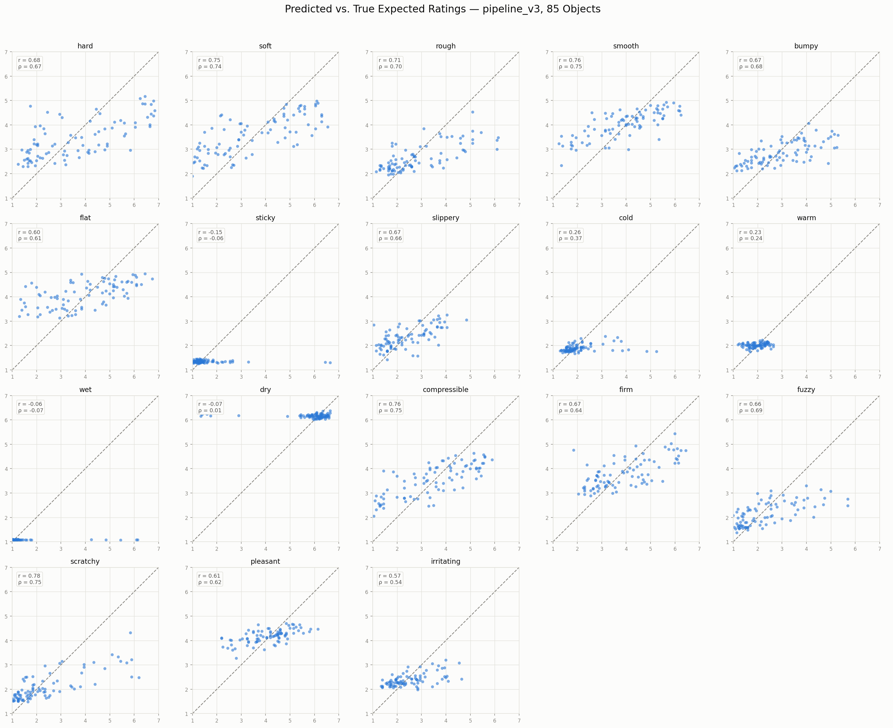

# Predicting Human Perceptual Distributions of Haptic Adjectives

This repository holds the code for the Master's thesis "Predicting Human Perceptual Distributions of Haptic Adjectives" by Samar (INSAT, Tunisia, and TU Dresden, LASR Lab). We recorded 85 everyday objects with a Meta DIGIT 360 tactile sensor. Twenty people rated the same objects on 18 haptic adjectives. A multimodal neural network takes the sensor recordings and predicts, for each object and adjective, the full distribution of human ratings over the 7-point scale, not only the mean. The code covers data collection, label building, preprocessing, training, evaluation and one negative-result experiment with Sparsh-X image features.

## Study

- 85 objects. Session 1 covers `obj_01`–`obj_45`, session 2 covers `obj_46`–`obj_85`.
- 20 participants.
- 18 adjectives: hard, soft, rough, smooth, bumpy, flat, sticky, slippery, cold, warm, wet, dry, compressible, firm, fuzzy, scratchy, pleasant, irritating.
- Ratings are on a 7-point unipolar scale (1–7).
- For each object and adjective, the ratings are turned into a 7-bin distribution: the fraction of participants who gave each rating.
- The label tensor has shape (85, 18, 7). A second file holds the expected rating per object and adjective, shape (85, 18).

The scripts in `human_study/` turn the questionnaire exports into these files. See `data/README.md` for the exact format.

## Sensor recordings

- Sensor: Meta DIGIT 360, recorded with ROS 2 Jazzy.
- Driver: the lab adaptation `digit360-ros2` (maintained by Niklas Leukroth, LASR) of `facebookresearch/digit360`. The driver was not modified.
- Each object was recorded with `data_collection/record2.sh` in four procedures: tap, squeeze, slide and hold.
- Each procedure has 5 trials, so there are 20 trials per object and 1,700 in total.
- `record2.sh` sets `TRIAL_DURATION=2`. It stops the recorder `TRIAL_DURATION + 2` seconds after starting it, and stored trials are about 4 s long (median).
- `record2.sh` records all topics. The recordings contain pressure, pressure_ap, imu_raw/euler/quat, ght, image_raw, mic_0 and mic_1.
- `data_collection/mcap_to_hdf5.py` converts the recordings into one HDF5 file per object. `data_prep/crop_images.py` then crops the tactile images.

## Model

The model works on single trials. At test time the trial predictions of an object are averaged.

It has four input branches. All features are z-scored with statistics from the training objects of the current fold only.

- **IMU.** The raw IMU log mixes four sensor streams. The code separates them and keeps the accelerometer stream. Its three axes are combined into one signal with DFT321 and high-pass filtered (4th-order Butterworth, 20 Hz, zero-phase). From this signal the code takes 5 MFCCs over a fixed 4 s window plus mean, standard deviation, minimum, maximum and RMS. That gives 10 values. An MLP maps them to 32 values.
- **pressure_ap.** The 50-channel pressure_ap array is cleaned of a known readout glitch (blocks of channels that read exactly 0). It is then resampled by linear interpolation to 224 time steps, giving shape (224, 50). A three-layer 2D CNN maps it to 64 values.
- **Audio.** A stereo log-mel spectrogram of shape (2, 64, T). It is computed with sample rate 48,000 Hz, 64 mel bands, n_fft 2048, hop length 512 and a Hann window (`np.hanning`); see `data/README.md`. A three-layer 2D CNN with global average pooling maps it to 64 values, so T can vary.
- **Tactile image.** Only squeeze and hold trials have an image. The cropped 224×224 image goes through a frozen ResNet-50 (ImageNet weights) for 2048 features, plus a 16-level grey-level co-occurrence matrix (distance 1, angle 0) for 256 features. ResNet dimensions that are constant over the training images of a fold are dropped, so the input width depends on the fold. A four-layer MLP (128, 256, 256, 128) maps them to 128 values.

The 288 branch outputs are concatenated. The image and audio outputs are set to zero when a trial has no image or no audio. An MLP head (128, 64) outputs 18 × 7 values, and a softmax over the 7 bins gives one distribution per adjective.

`pressure` and `ght` are recorded but deliberately not used.

### Training

- Object-level 5-fold cross-validation: each object is in exactly one test fold (17 objects per fold).
- Loss: EMD between predicted and human distributions (see below).
- Optimizer: Adam, learning rate 1e-4, weight decay 1e-4.
- Batch size 16, at most 100 epochs, gradient clipping at norm 1.0.
- Scheduler: ReduceLROnPlateau on the test-fold EMD, factor 0.5, patience 7.
- Early stopping: patience 15 on the test-fold EMD. The best epoch's checkpoint is used for the final scores.
- Default seed 42.

## Evaluation and metrics

All metrics are computed per object (trial predictions averaged), then averaged. EMD and MAE are averaged over the objects of a fold and then over the 5 folds.

- **EMD.** For each adjective: the mean, over the 7 bins, of the absolute difference between the predicted and the human cumulative distributions. Then averaged over the 18 adjectives. Implemented in `model/src/train.py`.
- **MAE.** The absolute difference between predicted and human expected ratings. The expected rating is the sum of k·p_k over the bins k = 1…7, so it lies on the 1–7 scale.
- **Pearson r.** For each adjective, the Pearson correlation between the true and predicted expected ratings over the 85 objects' out-of-fold predictions. The reported r is the mean of these 18 values (`analysis/results/mean_per_adjective_r.py`). A pooled r over all 1,530 object–adjective pairs is not used.

## Results

| Run | EMD | MAE | r |
|---|---|---|---|
| Main run (seed 42) | 0.1037 | 0.6837 | 0.506 |
| 5 seeds (42, 7, 99, 123, 2024), mean ± SD | 0.1047 ± 0.0011 | 0.6897 ± 0.0084 | 0.497 ± 0.014 |
| Adjective-weighted EMD (ablation) | 0.1196 | 0.7945 | 0.508 |
| Regularized, dropout 0.3, weight decay 5e-4 (ablation) | 0.1296 | 0.8733 | 0.014 |
| Sparsh-X image features (negative result, 75 objects only) | 0.1189 | 0.7934 | 0.286 |

SD is the sample standard deviation over the 5 seeds. EMD and MAE come from `results/*/final_results.json`. The r values come from the per-object predictions in `results/*/predictions_vs_truth.csv`. To recompute r for a run:

```bash
python analysis/results/mean_per_adjective_r.py --csv results/main_seed42/predictions_vs_truth.csv
```

**Per adjective (main run).** r is between about 0.57 and 0.78 for 13 adjectives. It is low for sticky, cold, warm, wet and dry (between −0.15 and 0.26). These five adjectives also have the lowest MAE. Their ratings cluster at one end of the scale, so a nearly constant prediction gets a low error without ranking the objects correctly.

### Results figures

All figures show the main run (seed 42, out-of-fold predictions). The heatmaps show one value per object and adjective.

**Session 1 (obj_01–obj_45).** Human mean ratings, model predictions, and prediction minus human mean:





**Session 2 (obj_46–obj_85).** Human mean ratings, model predictions, and prediction minus human mean:





**Predicted vs. true expected rating**, one panel per adjective, one dot per object:



## Repository structure

```
data_collection/        recording scripts (ROS 2) and .mcap -> HDF5 conversion
human_study/            questionnaire exports -> label distributions -> label files
  plots/                figures of the human ratings
data_prep/              tactile image cropping
model/
  src/                  features, dataset, model, training, paths.py
  slurm/                SLURM template for the training runs
experiments/sparsh_x/   Sparsh-X image-feature experiment, upstream patch, validation scripts
analysis/
  preprocessing/        signal checks used to choose the preprocessing
  figures/              example figures
  results/              result plots and metric scripts
tests/                  diagnostic checks for features, dataset and model (need the data)
results/                final_results.json, fold_k_results.json and predictions_vs_truth.csv of each reported run
data/labels/            aggregate label files (see data/README.md)
data/README.md          data layout
docs/figures/           result figures used in this README
```

Scripts write their outputs to `outputs/<script_name>/`. Training runs write to `outputs/train/results/` by default.

## Setup

```bash
python -m venv .venv
source .venv/bin/activate
pip install -r requirements.txt
```

Package versions are not pinned yet. `data_collection/` also needs ROS 2 Jazzy (for `rclpy` and `rosidl_runtime_py`). The Sparsh-X experiment needs a separate environment, see `experiments/sparsh_x/requirements.txt`.

## Configuration (environment variables)

All paths come from environment variables, read in `model/src/paths.py`. A missing required variable stops the script with an error that names it.

| Variable | Needed by | Meaning |
|---|---|---|
| `TACTILE_DATA_ROOT` | most scripts | folder with `hdf5/` and `hdf5_cropped_images/` |
| `TACTILE_LABELS_DIR` | training, analysis | folder with `labels_phase2.npy`, `labels_mean_phase2.npy`, `object_ids_phase2.npy` |
| `TACTILE_CACHE_DIR` | optional | feature cache, default `<repo>/cache` |
| `HUMAN_DATA_DIR` | `human_study/` | folder with the participant-level CSV files |
| `SPARSH_REPO` | Sparsh-X | patched clone of sparsh-multisensory-touch |
| `SPARSHX_FEATURES_DIR` | Sparsh-X, optional | default `<cache>/sparshx_features` |
| `SPARSHX_PICKLE_DIR` | Sparsh-X, optional | default `<cache>/sparshx_pickle` |
| `RAW_MCAP_FULL_DIR` | `precompute_sparshx_features.py` | raw .mcap recordings |
| `RAW_MCAP_TEST_DIR` | Sparsh-X validation scripts | raw .mcap recordings used for validation |
| `DATA_DIR`, `ROS_WS` | recording scripts | output folder (default `~/tactile_recordings`) and ROS 2 workspace (default `~/ros2_ws`) |

## How to run

Run the steps in this order. Paths inside the scripts are computed from the script location, so you can run them from any folder.

1. **Record** (on the sensor machine, once per sensor session, then once per object):
   ```bash
   DATA_DIR=~/tactile_recordings bash data_collection/record_idle.sh A
   DATA_DIR=~/tactile_recordings bash data_collection/record2.sh obj_01 A
   ```
2. **Convert to HDF5** (in a ROS 2 Jazzy environment):
   ```bash
   python3 data_collection/mcap_to_hdf5.py --data-root ~/tactile_recordings/A --output-root $TACTILE_DATA_ROOT [--obj obj_01] [--action tap] [--verify]
   ```
   `python3 data_collection/read_data.py <bag_folder>` prints a summary of one recording.
3. **Crop the tactile images:**
   ```bash
   python data_prep/crop_images.py
   ```
4. **Build the labels** (needs `HUMAN_DATA_DIR`):
   ```bash
   python human_study/reorganize_tactile_data.py
   python human_study/reorganize_session2_data.py
   python human_study/build_label_distributions.py
   python human_study/build_labels.py --out-dir $TACTILE_LABELS_DIR [--csv path/to/labels_distribution.csv]
   ```
5. **Precompute features** (optional, makes training much faster):
   ```bash
   python model/src/precompute_features.py
   ```
6. **Train:**
   ```bash
   python model/src/train.py [--seed 42] [--results-dir DIR] [--smoke-test] [--adjective-weighting]
   python model/src/train_regularized.py [--dropout 0.3] [--weight-decay 5e-4] [same flags as train.py]
   ```
   On a SLURM cluster, use `model/slurm/train.sbatch`. The comments in that file list the command for each reported run.
7. **Evaluate:**
   ```bash
   python analysis/results/mean_per_adjective_r.py --csv outputs/train/results/predictions_vs_truth.csv
   python analysis/results/plot_heatmap_predicted.py [--pred-csv FILE] [--labels-dir DIR] [--out-dir DIR] [--run-label TEXT] [--max-true-diff 0.01]
   python analysis/results/plot_predicted_vs_true_grid.py
   python analysis/results/plot_actual_vs_predicted_bars.py
   ```
   `diagnose_train_test_gap.py` and `single_object_distributions.py` read the checkpoints in `outputs/train/results/`.

The scripts in `tests/` and `analysis/preprocessing/` are diagnostics and need the data. Run `tests/17_dataset_v3_test.py` before 18–20, because they reuse its cached statistics. Run `analysis/preprocessing/06_*` before `07_*`.

## Sparsh-X experiment

This experiment replaces the image branch with Sparsh-X image embeddings (768 values per trial from the upstream image-only base checkpoint). The other branches and all training settings are unchanged.

1. Set up the upstream repository and environment as described in `experiments/sparsh_x/requirements.txt`. This includes applying `patches/sparsh_d360_compat.patch`, which holds two local compatibility patches.
2. Compute the embeddings: `python experiments/sparsh_x/precompute_sparshx_features.py` (or `experiments/sparsh_x/precompute.sbatch`).
3. Train: `python experiments/sparsh_x/train_sparshimg.py` with the same flags as `train.py` (or `experiments/sparsh_x/train_sparshimg.sbatch`).

Only 75 objects are used. Objects 09, 10, 11, 26 and 57–62 have no usable Sparsh-X image trials, because the microphone topics that the Sparsh-X loader needs are missing in those recordings. The cross-validation folds therefore differ from the main model's, so the comparison is not fold-matched. The scripts in `experiments/sparsh_x/validation/` were used to check the Sparsh-X pipeline.

## Limitations

1. **No validation split.** The held-out test fold selects the best epoch, triggers early stopping (patience 15), drives the learning-rate scheduler and produces the reported metrics. The reported scores are therefore optimistically biased. The size of this bias was not measured.
2. **Reproduction of the main run.** The main run in `results/` came from an earlier revision of `train.py`, before the `--adjective-weighting` option (off by default) was added. A re-run matched to 4 decimals at fold 1, epoch 2. Full bit-exact reproduction was not verified. No environment versions or hashes were recorded.
3. **Determinism is not guaranteed.** The code sets seeds and `cudnn.deterministic`, but does not call `torch.use_deterministic_algorithms`, and it uses 8 DataLoader workers.
4. **The feature cache does not invalidate itself.** Delete it after changing a feature extractor.
5. **The early CNN+LSTM baseline is not in this repository.** It is described in the thesis only.
6. **Five adjectives have low r:** sticky, cold, warm, wet and dry (see Results).

## Open items (unverified)

- Package versions are not pinned. Cluster runs used Python 3.9.
- Sampling rates are assumed in the code, not read from the data: IMU about 438 Hz raw (109.5 Hz per stream after separation), pressure_ap 248 Hz, audio 48,000 Hz. These are unverified.

## Data availability

Included:

- Aggregate labels in `data/labels/`: the per-object rating distributions and expected ratings for all 85 objects. You can set `TACTILE_LABELS_DIR` to this folder.
- Per-object predictions of each reported run in `results/*/predictions_vs_truth.csv`.

Not included: participant-level ratings and raw sensor recordings (and the HDF5 files made from them). `data/README.md` describes the data layout.

## Third-party code and credits

- **DFT321** (combining three accelerometer axes into one signal): Landin, Romano, McMahan, Kuchenbecker. [complete reference]
- **Image branch** (frozen ResNet + GLCM features, and the 128-256-256-128 MLP): following Awan & Jeon 2025. [complete reference]
- **ResNet-50 ImageNet weights** (`IMAGENET1K_V2`) via torchvision.
- **Sparsh-X:** `facebookresearch/sparsh-multisensory-touch`, commit `219ee2f30c52da6eba1071c0a8e71b24ec33a697`, CC BY-NC 4.0. The two local patches are in `experiments/sparsh_x/patches/sparsh_d360_compat.patch`. The checkpoints come from upstream and are not included.
- **DIGIT 360 driver:** adapted from `facebookresearch/digit360` (CC BY-NC 4.0). Lab adaptation `digit360-ros2` maintained by Niklas Leukroth (LASR); URL to be added.

## License

This work (code, patch files, data and figures) is licensed under CC BY-NC 4.0. See `LICENSE`, which also lists the third-party material.

## Acknowledgements

Thanks to Prof. Roberto Calandra and Prof. Merle Fairhurst, and the members of the LASR Lab at TU Dresden for their support. Thanks to Niklas Leukroth for the lab's ROS 2 adaptation of the DIGIT 360 driver, and to the 20 participants who took part in the perception study.
